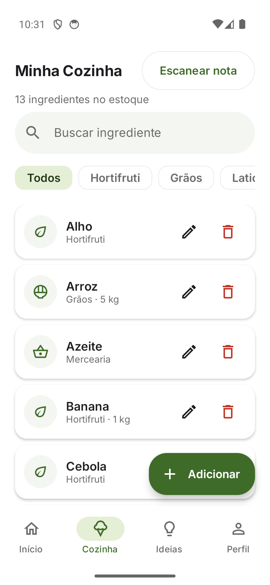
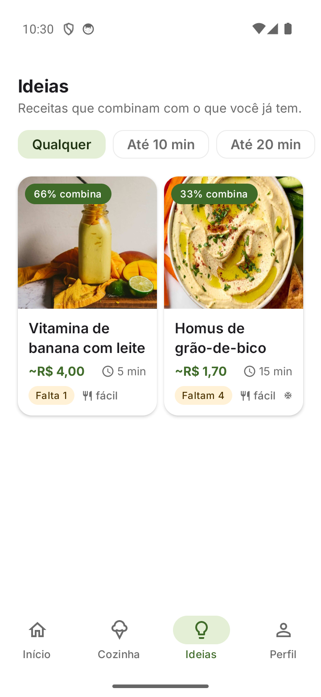
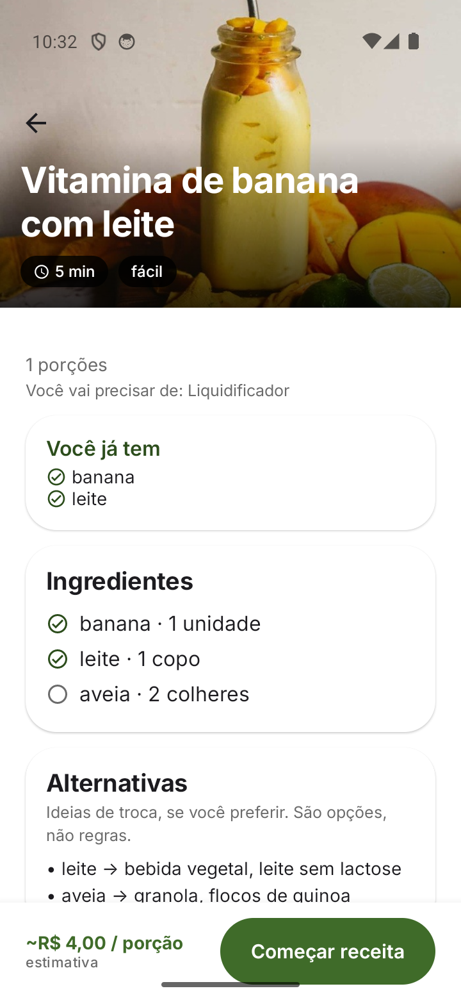

# Brigadeiro

> "Eu digo o que tenho → o Brigadeiro entende → organiza meus ingredientes → me mostra o que posso fazer."

Brigadeiro is a mobile-first Android assistant that helps you decide what to cook with
the ingredients you already have. You describe your kitchen by text, voice or a photo of
your grocery receipt, the app turns it into a structured inventory, and it suggests
recipes you can make right now.

It is **AI-assisted, not a chatbot**: AI/ML is used only where it adds value
(understanding language, speech, on-device OCR, ingredient extraction), while navigation,
storage, editing, filtering and validation are ordinary deterministic software.

## Screenshots

| Home | Minha Cozinha |
| --- | --- |
|  |  |

| Ideias | Receita |
| --- | --- |
|  |  |

## What works in this MVP

- **Onboarding** – a short, skippable wizard asks your dietary pattern
  (omnivore / pescatarian / vegetarian / vegan), restrictions (lactose, gluten, eggs,
  seafood, nuts, soy), your kitchen equipment (stove, oven, microwave, air fryer,
  blender, sandwich maker, pressure cooker, mixer) and whether you want freezer-friendly
  meals.
- **Home** – a delivery-style feed: search/ingredients, category shortcuts, a featured
  banner, a recipe carousel and a visible stock card with the item count.
- **Text & voice input** – the mic uses the platform recognizer, preferring the on-device
  engine and falling back to the system voice UI, and always explains a failure instead
  of failing silently.
- **Adicionar por foto** – snap a grocery receipt (or pick one from the gallery);
  on-device OCR (ML Kit) extracts the food items and you review/edit everything before it
  enters the inventory. Nothing is added silently.
- **Minha Cozinha** – offline inventory: add, edit, remove, search and filter by category,
  with a stock summary and a one-tap "Escanear nota".
- **Confirmação** – the app shows what it understood (from text or a receipt) and lets you
  correct it before saving.
- **Ideias** – delivery-style cards (photo, total time, estimated cost, difficulty,
  availability) scored against your inventory and filtered by your diet and equipment,
  with time filters (10/20/30 min / any) and a full recipe detail.
- **Substituições** – each recipe suggests ingredient swaps as options, never as rules.
- **Offline-first** – opening, inventory management, heuristic extraction, recipe ideas and
  receipt OCR all work without internet.

The product spec lives in [docs/SDD.md](docs/SDD.md).

## Requirements

- JDK 17
- Android SDK with platform **android-34** and build-tools 34.0.0
- An Android device or emulator (minSdk 29, targetSdk 34)
- The Gradle wrapper is committed; no global Gradle needed

Set `JAVA_HOME` and point the SDK either through `ANDROID_HOME`/`ANDROID_SDK_ROOT` or a
local `local.properties` with `sdk.dir=/path/to/android-sdk` (that file is git-ignored).

## Build & test

```bash
export JAVA_HOME=/path/to/jdk17
export PATH="$JAVA_HOME/bin:$PATH"

./gradlew :app:assembleDebug      # debug APK -> app/build/outputs/apk/debug/app-debug.apk
./gradlew :app:testDebugUnitTest  # unit + Robolectric UI tests
```

Install on a connected device:

```bash
adb install -r app/build/outputs/apk/debug/app-debug.apk
```

### Test without handling the APK (wireless ADB)

Build, install and launch in one command (USB or wireless):

```bash
scripts/install-debug.sh
```

First-time wireless pairing (phone on the same Wi-Fi, Android 11+):

```bash
scripts/wireless-adb.sh pair    <ip:port> <pairing-code>   # wireless debugging screen
scripts/wireless-adb.sh connect <ip:port>
scripts/install-debug.sh
```

After pairing once, only `scripts/install-debug.sh` is needed: Gradle builds and
`adb install`s the APK straight to the phone and opens the app — no manual APK copying.
Under WSL2, if the phone is not reachable, start the ADB server on Windows
(`adb.exe -a nodaemon server start`) and set `ADB_SERVER_SOCKET=tcp:<windows-host-ip>:5037`.

### Emulator

The helper scripts assume the Android SDK under `$ANDROID_HOME` (or `$ANDROID_SDK_ROOT`):

```bash
scripts/run-emulator.sh            # headless (stable under WSL2)
EMU_WINDOW=1 scripts/run-emulator.sh   # window (WSLg)
EMU_AUDIO=1  scripts/run-emulator.sh   # expose a microphone to the guest
```

## Architecture (summary)

```
app/src/main/java/com/brigadeiro/app
├── di/            AppContainer + ViewModelFactory (manual DI)
├── data/          Room database, DataStore settings, OkHttp remote client, repositories
├── domain/        models, repository interfaces, use cases
├── ai/            AIProvider (fake/local/remote), extractors, RecipeGenerator, receipt OCR
├── audio/         SpeechToTextService contract (+ optional Whisper backend)
└── ui/            theme, components, navigation, screens, voice controller
```

The UI talks to ViewModels, ViewModels to use cases, use cases to repository/generator
interfaces, and the data layer to Room. The AI layer is fully replaceable. See
[docs/ARCHITECTURE.md](docs/ARCHITECTURE.md) for detail and [docs/AI.md](docs/AI.md) for
the AI/ML design.

## Privacy

Local-first. The inventory stays in a local Room database. Voice is requested only when
you tap the microphone, and receipt photos are read on-device by ML Kit (no image is
uploaded). No credentials are hardcoded and no data is sent anywhere unless you explicitly
configure an optional remote recipe provider.

Recipe photos are illustrative and hotlinked from TheMealDB; the app falls back to locally
drawn illustrated tiles when offline.

## Emulator notes

The Android emulator has no real microphone, so voice can only be smoke-tested there
(permission prompt, listening state, and fallback/timeout messages) — real transcription
needs a device. Receipt OCR works on the emulator and can be tested with a photo placed in
the gallery.

## Model files

No model binaries are committed (`.gguf`, `.bin`, `.task`, `.litertlm` are git-ignored).
The app runs fully without any model; downloaded models are optional enhancements. See
[docs/AI.md](docs/AI.md).

## License

MIT — see [LICENSE](LICENSE). Third-party components and their licenses are listed in
[THIRD_PARTY_NOTICES.md](THIRD_PARTY_NOTICES.md).
